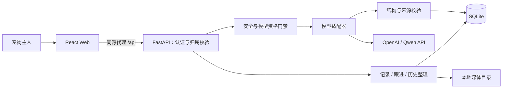

# RelaPaw

RelaPaw 是面向宠物主人的观察记录与人宠关系整理工具：保留客观观察，单独记录自己的理解，通过后续跟进和历史回看认识变化。当前是持续迭代的本地响应式 Web 项目。

**Observation ≠ Interpretation（观察不等于解释）**。项目不替宠物说话，也不进行疾病或心理诊断；AI 用于辅助整理有来源的信息，生成内容不覆盖原始记录。

## 已实现功能与用户流程

1. **登录与建档**：受邀邮箱验证码登录，同意数据约定并完成引导；创建、编辑和切换多只宠物，管理头像、归档与恢复，以及照护背景。
2. **记录当下**：保存主人原话，选填客观观察和主人理解，填写安全检查并关联观察计划；为记录、生活事件或关系事件添加图片、视频和说明。
3. **查看与跟进**：在“今天”查看近期记录、计划和到期复评；在“记录 / 足迹”搜索、查看和修订记录，查看旧版本。完成复评会生成与原记录双向关联的新记录，也可取消跟进。
4. **整理长期变化**：在“我们”维护生活事件、主人与宠物或多宠关系事件；管理手工长期记忆及其修订、纳入和撤回，查看人工基线与 7 / 30 / 90 天量化基线。多条跨日关系证据可组成互动模式候选，由用户确认、拒绝或修订；媒体支持历史查看与并排比较。
5. **辅助理解与数据管理**：模型能力启用且满足门禁时，可从记录详情提取原文事实 / 理解候选，或结合近期记录和受控资料生成辅助整理，保留来源与不确定性。账户支持 JSON 导出及删除请求；导出含媒体元数据，原文件需在媒体入口分别保存。

**默认不启用 AI**。无模型配置时，登录、宠物管理、记录、媒体、复评、关系事件、手工记忆、基线和数据管理仍可使用；新的 AI 提取和辅助整理不可用。媒体用于保存和查看，不代表已经实现图像或视频模型分析。

## 工程亮点

- **会话与请求防护**：验证码具有有效期、单次使用和请求 / 验证限流；随机会话令牌与 CSRF 令牌以 HMAC 摘要保存。浏览器使用 HttpOnly、SameSite Cookie，写请求校验 Origin 和 CSRF，并支持会话到期与撤销，降低登录态泄露和跨站写入风险。见[认证路由](backend/app/api/routes/auth.py)、[身份服务](backend/app/services/identity.py)和[会话服务](backend/app/services/sessions.py)。
- **按资源归属隔离数据**：后端从会话取得用户，沿宠物归属校验记录、计划、跟进及派生资源，跨用户访问返回 404，避免只靠界面隐藏入口。见[归属校验](backend/app/api/deps.py)和[隔离测试](backend/tests/test_identity_tenancy.py)。
- **历史变化可追溯**：原话、观察和理解分开存储，修订保留版本，跟进关联原记录；量化基线保留窗口、算法版本、样本状态和来源快照，便于判断汇总来自哪些记录。见[实体模型](backend/app/models/entities.py)、[跟进服务](backend/app/services/follow_ups.py)和[基线计算](backend/app/services/baseline.py)。
- **数据演进与隐私生命周期**：Pydantic 校验输入，Alembic 管理连续迁移；导出按用户筛选并排除会话秘密，删除请求撤销访问，后续清理任务处理到期数据与媒体。见[迁移目录](backend/alembic/versions)、[隐私服务](backend/app/services/privacy.py)和[清理任务](backend/app/jobs/privacy_retention.py)。
- **模型输出经过结构与来源校验**：适配器区分超时、鉴权、限流、拒答和无效输出；提取校验原文片段与分类，辅助整理校验记录来源和逐条资料引用。运行时资格绑定模型、端点、契约、知识版本与证据，缺失、撤销或漂移时阻断；调用保留成功 / 失败状态，生成结果不直接改写事实或长期记忆。见[提取服务](backend/app/services/understanding.py)、[辅助整理](backend/app/services/assistant_guidance.py)和[资格门禁](backend/app/services/model_qualification.py)。

## 技术栈与架构

| 层次 | 当前实现 |
| --- | --- |
| 前端 | React 19、TypeScript、Vite；Context 管理登录、当前宠物与能力状态，响应式页面 |
| 后端 | Python、FastAPI、Pydantic、SQLAlchemy；REST API 与 Cookie 会话 |
| 数据 | **当前本地运行和验收使用 SQLite**，启用外键；Alembic 管理迁移，媒体原文件存本地目录 |
| 模型 | OpenAI Python SDK；文本提取适配 Responses API 与 Qwen 的 OpenAI 兼容 Chat Completions，辅助整理使用独立适配器 |
| 验证 | pytest、Vitest / Testing Library、Playwright，以及离线、录制输出和限额真实模型评估 |



代码包含 PostgreSQL 驱动、兼容处理及 staging / production 的 PostgreSQL 配置约束；这些属于迁移准备与环境门禁，不能视为 PostgreSQL 生产运行验证。当前不宣称公网部署或生产交付。

## 与 Observation Notes Recall Skill 的关系

Observation Notes Recall Skill 是同一 RelaPaw 产品体系下的独立 Skill 工程成果，作为观察笔记回顾方向的配套成果。当前仓库前后端未建立对该 Skill 的调用链，因此主项目不标为已集成；本文产品能力和验证结果均仅指本仓库，不包含 Skill 的功能或验证成绩。

## 本地启动

以下以 Windows PowerShell、仓库目录 `E:\Relapaw` 为例，其他位置请替换路径。已有验收使用 Python 3.14、Node.js 24；后端项目声明 Python >= 3.11。依赖以[后端依赖](backend/requirements.txt)和[前端锁文件](frontend/package-lock.json)为准。

### 终端一：后端与空库

```powershell
Set-Location E:\Relapaw\backend
python -m venv .venv
.\.venv\Scripts\python.exe -m pip install -r requirements-dev.txt

# 仅清除当前终端继承的项目 / 供应商配置，使用独立本地数据。
Get-ChildItem Env: | Where-Object Name -Match '^(RELAPAW_|RESEND_|OPENAI_|DASHSCOPE_|QWEN_)' |
  ForEach-Object { Remove-Item -LiteralPath ("Env:" + $_.Name) }
$env:RELAPAW_DISABLE_DOTENV = '1'
$env:RELAPAW_ENV = 'development'
$env:RELAPAW_AI_ENABLED = 'false'
$env:RELAPAW_EMAIL_IDENTITY_MODE = 'local'
$env:RELAPAW_LOCAL_INVITE_CODE = '246810'
$env:RELAPAW_SESSION_PEPPER = 'local-development-only-change-me'
$env:RELAPAW_CORS_ORIGINS = '["http://127.0.0.1:5173"]'
$localDataDir = Join-Path $env:TEMP ("relapaw-local-" + [guid]::NewGuid().ToString("N"))
New-Item -ItemType Directory $localDataDir | Out-Null
$env:RELAPAW_DATABASE_URL = 'sqlite:///' + ((Join-Path $localDataDir 'relapaw.db') -replace '\\', '/')
$env:RELAPAW_MEDIA_DIR = Join-Path $localDataDir 'relapaw_media'

.\.venv\Scripts\python.exe -m alembic upgrade head
.\.venv\Scripts\python.exe -m app.demo.invite_local first@example.test
.\.venv\Scripts\python.exe -m app.demo.invite_local second@example.test
.\.venv\Scripts\python.exe -m uvicorn app.main:app --host 127.0.0.1 --port 8000
```

保留 `$localDataDir` 的实际路径；重启时复用同一数据库、媒体路径和 session pepper 才能继续使用原数据。重新执行建目录命令会创建另一套空数据。后端提供 [API 文档](http://127.0.0.1:8000/docs)和[就绪检查](http://127.0.0.1:8000/ready)，后者检查数据库和迁移版本。

### 终端二：前端

```powershell
Set-Location E:\Relapaw\frontend
npm.cmd ci
$env:VITE_API_PROXY_TARGET = 'http://127.0.0.1:8000'
npm.cmd run dev -- --host 127.0.0.1 --port 5173 --strictPort
```

访问 [RelaPaw 本地页面](http://127.0.0.1:5173/)，使用 `first@example.test` 获取验证码并输入固定本地测试码 `246810`，登录后同意数据约定、完成引导并建档。此模式不发送邮件。第二个合成账号可在无痕窗口体验独立数据。两端停止均使用 Ctrl+C。

完整变量见 [.env.example](.env.example)和[配置实现](backend/app/core/config.py)；若改用 `backend/.env`，需取消 `RELAPAW_DISABLE_DOTENV=1` 并留意终端变量的优先级。Resend 邮件模式还需要 `RESEND_API_KEY` 与 `RELAPAW_RESEND_FROM_EMAIL`。

模型配置包括 `OPENAI_API_KEY`、`RELAPAW_OPENAI_MODEL`、`RELAPAW_MODEL_PROVIDER` 和可选的 `RELAPAW_OPENAI_BASE_URL`。**填写密钥或打开 AI 开关并不足以启用功能**：还需设置 `RELAPAW_MODEL_QUALIFICATION=QUALIFIED`、选择与仓库证据及迁移登记一致的 `RELAPAW_MODEL_QUALIFICATION_ID`，运行时校验通过才可调用；默认保持关闭。见[外部依赖与历史验证](docs/PRODUCT_EXPERIENCE_BETA_EXTERNAL_DEPENDENCIES.md)。

固定合成演示可在安装依赖后从仓库根目录依次执行 `./scripts/demo.ps1 start`、`./scripts/demo.ps1 verify`、`./scripts/demo.ps1 stop`，访问 `http://127.0.0.1:8000/`；账号为 `demo@example.test`，本地码为 `246810`。见[演示手册](docs/DEMO_OPERATOR_GUIDE.md)，备份恢复见[数据手册](docs/LOCAL_ALPHA_GUIDE.md#备份与恢复)。当前未完成 Docker 部署验证，不提供 Docker 启动流程。

## 测试与当前进度

以下为仓库留存的历史证据；2026-11-16 本轮仅核对文档、源码与记录，没有重跑业务测试、启动服务或操作数据库。

| 类型与日期 / 版本 | 已记录结果与范围 |
| --- | --- |
| 自动化回归，2026-11-07 验收记录 | 前轮后端全量 261 项通过；该轮后端跟进 / 关系 / 媒体 / 隐私专项 22 项、前端全量 120 项通过，TypeScript 与构建通过；该轮未重复后端全量。 |
| 浏览器，2026-11-07 | Playwright 6/6，通过桌面与移动 Chromium 视口的记录、复评、关系候选、媒体及双账号隔离等旅程；邮件为本地码 / 假投递，AI 关闭。不是移动真机验证。 |
| 离线与录制模型输出，2026-10-13 | 离线 9/9、录制输出 14/14 匹配冻结期待；证明评估规则与契约行为，不证明真实模型语义质量。 |
| 真实模型，2026-10-13 | 旧 `qwen3.8-flash + text-understanding/v5` 人工语义评审未通过，结论为 `NOT_QUALIFIED`，不能用自动门禁通过替代该结论。 |
| 真实模型，2026-10-26 | 固定 `qwen3.7-plus-2026-05-26` 的 v7 原文提取 2 例与 guidance v4 辅助整理 2 例通过确定性校验和人工评审；后者复用前者证据，组合取得限定资格。另有合成数据的真实产品 API smoke 各 1 次。这些少量样本不代表广泛模型效果，默认 AI 仍关闭。 |

来源：[本地功能验收](docs/LOCAL_FUNCTIONAL_ACCEPTANCE.md)、[旧模型评估报告](docs/development/evaluation-safety/07_FINAL_REPORT.md)、[新版人工评审](backend/evals/live_qualification_qwen_beijing_v4_review.md)、[外部依赖记录](docs/PRODUCT_EXPERIENCE_BETA_EXTERNAL_DEPENDENCIES.md)。当前代码和测试仍包含复评刷新、多宠建档、资源隔离、资格撤销和输出来源校验；历史结果不等于本轮重新验证。

自行复验时，在干净终端清除继承的项目配置并设 `RELAPAW_DISABLE_DOTENV=1`，从 `backend` 执行 `.\.venv\Scripts\python.exe -m pytest -q`；从 `frontend` 执行 `npm.cmd test` 和 `npm.cmd run build`。浏览器测试先设 `$env:PLAYWRIGHT_BROWSERS_PATH = '0'`、执行 `npx.cmd playwright install chromium`，再运行 `npm.cmd run test:e2e`；它会启动隔离服务和测试数据，范围见[Playwright 配置](frontend/playwright.config.ts)。自动化模型用例使用假客户端 / 适配器，真实模型评估另行区分。

当前重点是完善本地体验与验证覆盖：部分基线窗口、媒体和记忆分支尚缺独立浏览器证据，移动真机仍待验证；原文件批量导出及删除回执等体验范围待确定。医疗安全内容与正式条款仍待专业审核，公开部署尚未完成。详细边界见[本地验收剩余项](docs/LOCAL_FUNCTIONAL_ACCEPTANCE.md)。
